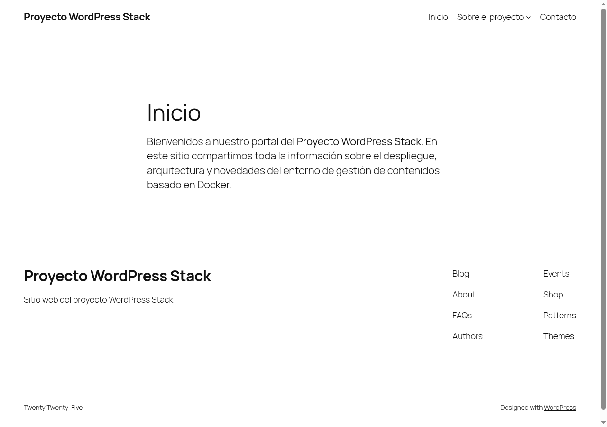
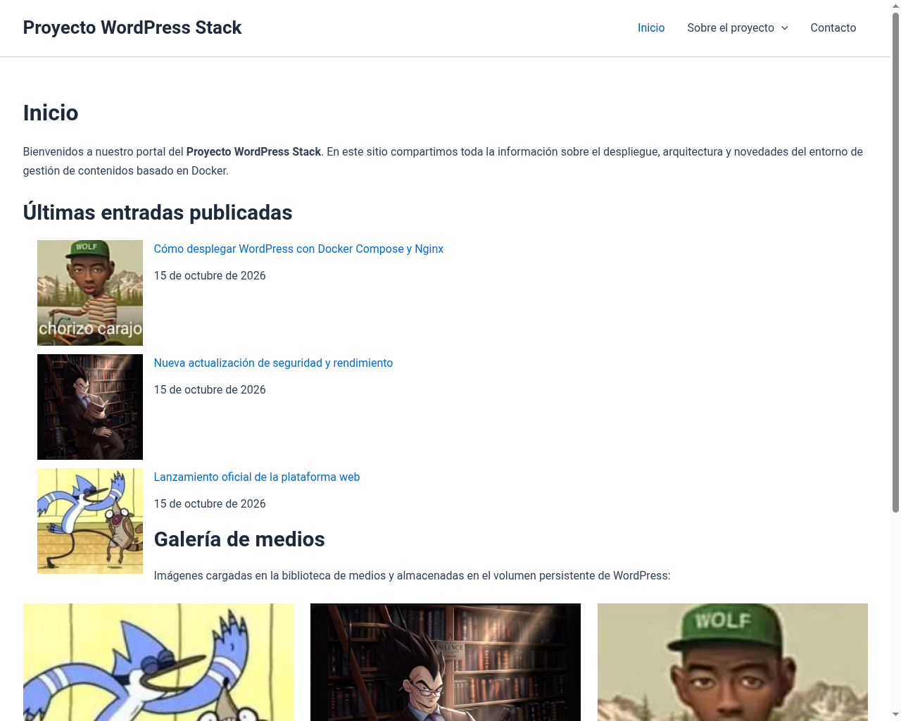
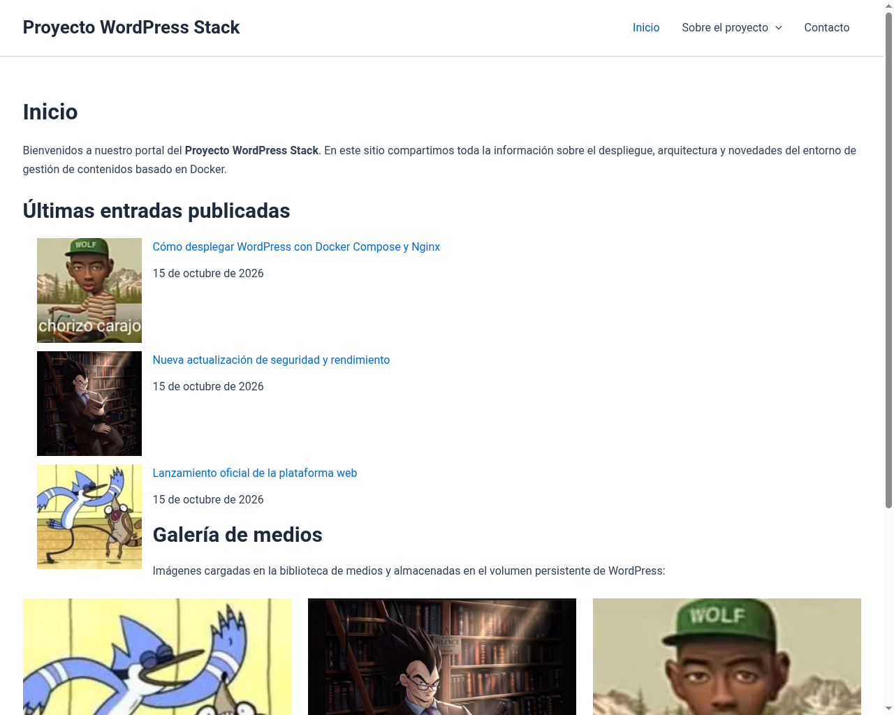
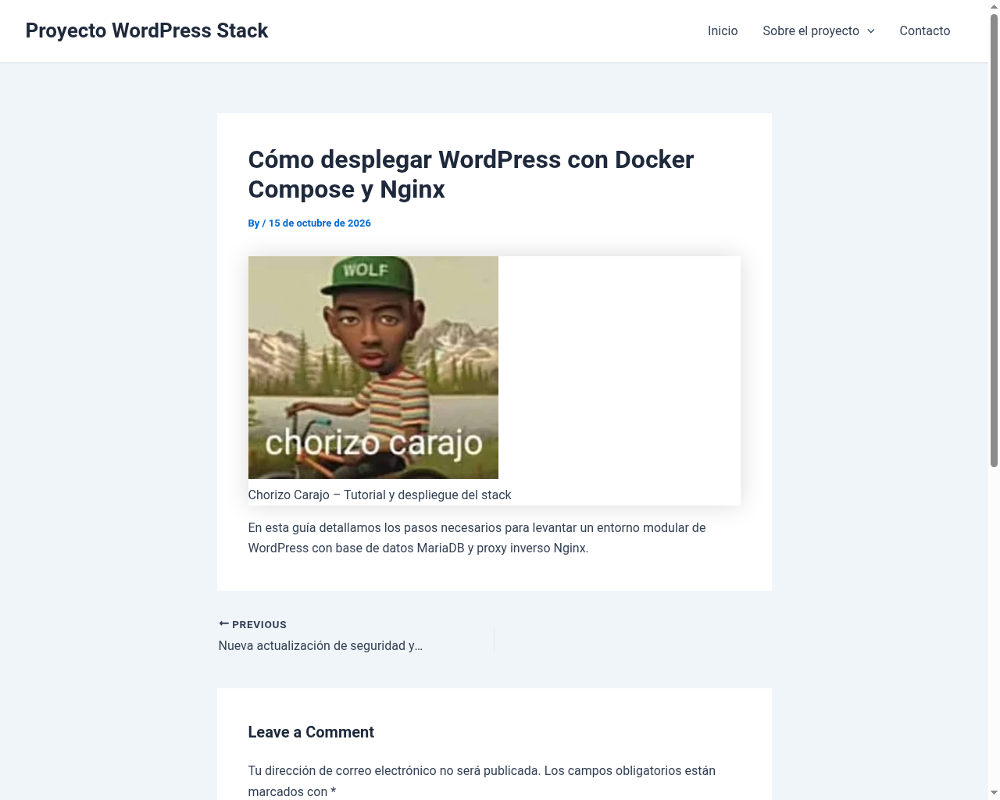
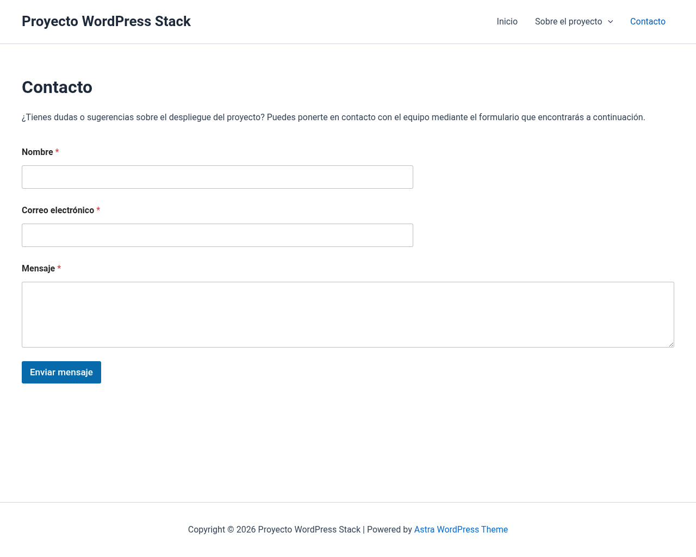

# Personalización del sitio

- **Tema activo:** Astra (versión 4.14.1).
- **Por qué lo elegí:** Es un tema ampliamente reconocido en el ecosistema WordPress por su ligereza, velocidad de carga y rendimiento optimizado. Permite una personalización completa desde el personalizador y editor (esquemas de color, tipografía y cabeceras/pies de página) sin sobrecargar la instalación de dependencias innecesarias, garantizando total compatibilidad con el editor de bloques y diseño adaptativo (*responsive*).
- **Plugin instalado:** WPForms Lite (versión 2.0.2.2, última actualización: 06/10/2026, más de 5.000.000 de instalaciones activas).
- **Por qué lo necesito:** Cumple con todos los criterios de seguridad y mantenimiento (ampliamente probado, actualizado frecuentemente y compatible con WordPress 6.7). Permite insertar de forma rápida y accesible un formulario de contacto profesional en la página de «Contacto», evitando exponer direcciones de correo electrónico directas y protegiendo el sitio contra spam.

---

## 1. Ajustes básicos (Paso 2)

- **Ajustes → Generales:**
  - **Idioma del sitio:** Español (`es_ES`).
  - **Zona horaria:** `Madrid` (`Europe/Madrid`).
  - **Título del sitio:** *Proyecto WordPress Stack*.
  - **Descripción corta:** *Sitio web del proyecto WordPress Stack*.
- **Ajustes → Enlaces permanentes:**
  - Configurado en **Nombre de la entrada** (`/%postname%/`).
  - Verificado en [nginx/default.conf](file:///home/sersalgom2/Documents/proyecto-wordpress-stack/nginx/default.conf) que la directiva `try_files $uri $uri/ /index.php?$args;` procesa las URLs amigables sin errores 404.
- **Ajustes → Comentarios:**
  - Activada la opción para que el comentario deba ser aprobado manualmente por un administrador antes de publicarse (`comment_moderation = 1`).

---

## 2. Estructura de contenidos (Paso 3)

### Portada estática
- Configurada desde **Ajustes → Lectura:**
  - **Tu portada muestra:** «Una página estática».
  - **Portada:** «Inicio».

### Páginas creadas (3 páginas + 1 página hija)
1. **Inicio:** Configurada como portada estática. Presenta la bienvenida al portal, las últimas publicaciones del proyecto y la galería de imágenes subidas al volumen.
2. **Sobre el proyecto:** Página principal que documenta el propósito de la arquitectura contenerizada.
   - **Tecnologías:** Página hija anidada bajo *Sobre el proyecto*, detallando la infraestructura del stack (Docker Compose, Nginx, PHP-FPM 8.3, MariaDB 11 y WordPress).
3. **Contacto:** Página que incorpora el formulario interactivo para consultas y sugerencias mediante el shortcode del plugin WPForms.

### 3 entradas repartidas en 2 categorías
- **Categoría: Novedades**
  1. *Lanzamiento oficial de la plataforma web:* Anuncio de la puesta en marcha de la infraestructura web basada en contenedores. Contiene la imagen adjunta `mordecai.jpg`.
  2. *Nueva actualización de seguridad y rendimiento:* Detalle de los ajustes aplicados en PHP-FPM y Nginx. Contiene la imagen adjunta `vegeta.png`.
- **Categoría: Tutoriales**
  3. *Cómo desplegar WordPress con Docker Compose y Nginx:* Guía paso a paso sobre el levantamiento modular de los servicios. Contiene la imagen adjunta `chorizo carajo.webp`.

### Menú principal
- Creado en **Apariencia → Menús** con el nombre `Menú Principal` y asignado a la ubicación principal (**Primary Menu**) del tema Astra.
- **Jerarquía y orden de navegación:**
  1. Inicio
  2. Sobre el proyecto
     - ↳ **Tecnologías** (subelemento anidado)
  3. Contacto

---

## 3. Subida de imágenes y persistencia en volumen (Paso 4)

Se han subido las 3 imágenes a la biblioteca de medios de WordPress:
1. `mordecai.jpg` (42 KB, formato JPEG).
2. `vegeta.png` (297 KB, formato PNG).
3. `chorizo carajo.webp` (11 KB, formato WebP).

### Verificación del volumen en el contenedor
Al ejecutar el comando indicado en la guía:
```bash
docker compose exec wordpress ls -R /var/www/html/wp-content/uploads
```

Se comprueba que las imágenes se organizan correctamente por año y mes dentro del volumen persistente:
```text
/var/www/html/wp-content/uploads:
2026

/var/www/html/wp-content/uploads/2026:
10

/var/www/html/wp-content/uploads/2026/10:
chorizo-carajo-150x150.webp
chorizo-carajo-300x267.webp
chorizo-carajo.webp
mordecai-150x150.jpg
mordecai-300x233.jpg
mordecai.jpg
vegeta-150x150.png
vegeta-295x300.png
vegeta.png
```

---

## 4. Configuración de límites de PHP en Git (Paso 6)

Para gestionar cargas en el servidor y asegurar la configuración requerida, se configuró el archivo [config/uploads.ini](file:///home/sersalgom2/Documents/proyecto-wordpress-stack/config/uploads.ini):
```ini
; Límites de PHP para WordPress
upload_max_filesize = 64M
post_max_size = 64M
memory_limit = 256M
```

Y se montó en modo solo lectura en el servicio `wordpress` de [docker-compose.yml](file:///home/sersalgom2/Documents/proyecto-wordpress-stack/docker-compose.yml):
```yaml
    volumes:
      - wp_data:/var/www/html
      - ./config/uploads.ini:/usr/local/etc/php/conf.d/uploads.ini:ro
```

### Comprobación con PHP-CLI
```bash
docker compose exec wordpress php -i | grep -E "upload_max_filesize|post_max_size"
```
Salida obtenida:
```text
post_max_size => 64M => 64M
upload_max_filesize => 64M => 64M
```

---

## 5. Evidencias visuales de la sesión

### Cambio de tema

#### Tema inicial (Twenty Twenty-Five)


#### Tema final personalizado (Astra)


### Portada estática con Menú, Últimas Entradas y Galería de Imágenes (Mordecai, Vegeta y Chorizo Carajo)


### Detalle de entrada con imagen asociada


### Formulario de contacto (Plugin WPForms Lite)

